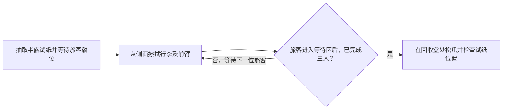

# 机场 Checkpoint Code Policy

仿真候选源码快照。控制入口为 `airport.checkpoint.deployment.run_policy`，策略状态机在 `airport/checkpoint/policy.py`。工作流见 `SKILL.md`，接口契约和历史实验见 `reference/`，配置见 `config/`。

运行依赖完整 RSI 仓库的机场场景、资产、控制原语、Isaac Sim 环境和对应 backend。在对应源码版本的 RSI 工作区用 `scripts/run_checkpoint_training.py` 查看训练入口和参数。冻结控制入口无需 LLM 或 VLA。现有记录尚无三人批次完整原生成功，具体见包内实验说明。

## 流程展示

旧机场回放已随运行产物清理。下图展示候选策略在三人批次中的预期流程。

