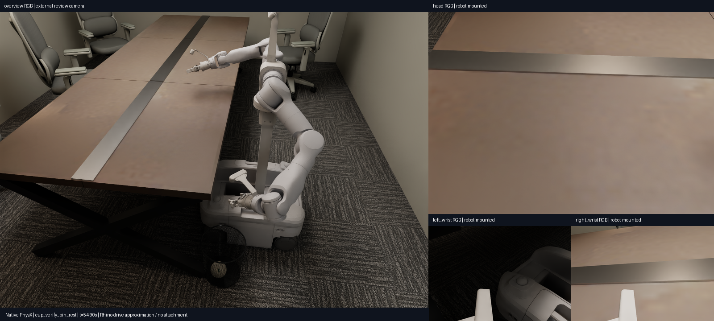

# Tianji 杯子入桶 Code Policy

入口为 `policy.py` 的 `policy(robo)`。使用 OpenCV、NumPy 和 SciPy，接入 RSI 的 PyRUA-Lean Tianji RGB backend。根据头部和腕部 RGB 定位杯子及桶口，侧夹杯身、抬升、搬运、释放和撤离。输出 16 维动作，右臂保持初始指令。运行期无需 LLM 或 VLA。

## 演示



- 固定场景参考轨迹展示侧夹杯身、搬运与入桶，由人工编排并通过原生判定。[观看完整投放](evidence/reference_demo.mp4)
- 本目录的 RGB 候选在 seed 101 触发底盘接触保护。seed 102 通过原生判定，现存记录为 JSON。[观看 seed 101 失败回放](evidence/seed_101/replay.mp4) · [查看 seed 102 判定](evidence/seed_102/sealed_verdict.json)

在 RSI 仓库根目录激活环境后，使用现有冻结回放入口：

```bash
source scripts/activate_airport.sh
python scripts/run_tianji_rtx_replay.py --candidate <策略版本目录>   --out runs/tianji_cleanup/<新目录> --seed 102 --scenario nominal --gpu <空闲GPU>
```

运行依赖 RSI 的仿真环境、机器人资产和远端 Isaac Sim 配置。原生冻结开发回归为 1/2，seed 102 成功，seed 101 杯体与底盘接触导致停机。逐条判定在 `evidence/`，策略说明在 `SKILL.md`。本版本为仿真候选。
