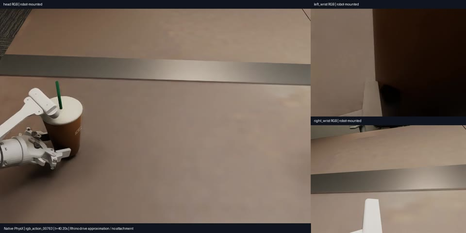

# Tianji 杯子入桶 Code Policy

入口为 `policy.py` 的 `policy(robo)`。使用 OpenCV、NumPy 和 SciPy，接入 RSI 的 PyRUA-Lean Tianji RGB backend。根据头部和腕部 RGB 定位杯子及桶口，侧夹杯身、抬升、搬运、释放和撤离。输出 16 维动作，右臂保持初始指令。运行期无需 LLM 或 VLA。

## 演示

本次 Isaac Sim 发布验证使用 seed 102，从复位执行侧夹杯身、抬升、搬运及释放。原生判定确认杯子完全入桶，由桶体支撑且已脱离夹爪。



[观看本次成功回放（2 倍速）](evidence/success.mp4) · [原生判定](evidence/release_verdict.json)

此前 seed 101 触发底盘接触保护。[失败回放](evidence/seed_101/replay.mp4)

## 复现

在 RSI 仓库根目录激活环境后，使用现有冻结回放入口：

```bash
source scripts/activate_airport.sh
TIANJI_NO_VIDEO=0 python - <<'PYCODE'
from scripts.run_tianji_rgb_evolution import frozen

frozen(
    "RSI-CodePolicies/tianji_cleanup_policy",
    "runs/tianji_cleanup/check_release/seed_102",
    seed=102,
    gpu=7,
    scenario="nominal",
)
PYCODE
python scripts/finalize_tianji_rgb_runs.py runs/tianji_cleanup/check_release
```

运行依赖 RSI 本地仿真适配代码、机器人资产和远端 Isaac Sim。将 GPU 号设为可用设备，每次使用新输出目录。历史冻结开发回归为 1/2，本次重新验证了 seed 102；适用范围限于仿真。
