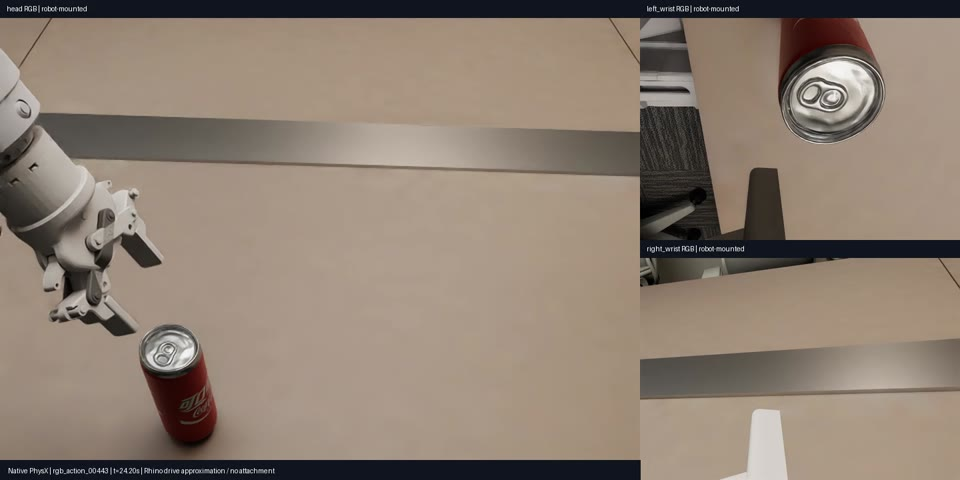

# Tianji 单左臂可乐 Policy 交付包

本包交付 `v000003`：左臂抓取桌上单个红色可乐罐，搬到 **head 图像中央 20% 区域**，放下、释放并撤离。右臂保持初始指令。运行策略不调用 LLM、VLA 或网络服务。

## 演示



Isaac Sim 成功实例展示左臂抓罐、搬运、释放和撤离，视频为 2 倍速。[观看三视角回放](evidence/success.mp4)

## 交付内容

| 路径 | 用途 |
| --- | --- |
| `tianji_cola/policy.py` | 原样冻结的最终策略，唯一维护入口 |
| `tianji_cola/SKILL.md` | 精炼后的操作逻辑与已确认经验 |
| `tianji_cola/interface.py` | 真机驱动需要实现的 Python 接口 |
| `tianji_cola/perception.py` | 原样复用的 RGB 罐口拟合 primitive |
| `tianji_cola/run.py` | 哈希核验、对接记录检查、失败停止封装 |
| `DEPLOYMENT.md` | 技术路线、接口返回格式与真机对接步骤 |
| `config/` | 仿真参考标定、模型版本、未完成的真机配置模板 |
| `reference/` | 原项目 FK/IK、几何、PyRUA 适配参考源码；不作为真机驱动运行 |
| `evidence/` | 12 项原生回归、协议、成功三视角视频（2 倍速） |
| `tests/` | 交付包离线契约测试，不计为真机或仿真成功 |

## 验证范围

`evidence/full_matrix.json` 记录固定 12 项 Isaac Sim 原生回归全部成功：seed 101–103 × `pick_goal` / `combined_goal` × 2 次。每条记录的策略哈希一致，LLM/VLA 调用数均为 0。未测试额外未见布局，**未完成真机部署验证**。新交付封装未经过该仿真回归。

策略 SHA-256：`2569babba60a3f8be6afd1db02d6b8048773fd76abcd18453de532376173188f`。

## 使用

先在本版本目录运行（不连接机器人）：

```bash
python3 check_delivery.py
python -m unittest discover -s tests -v
```

控制环境参考版本为 Python 3.11.13，依赖见 `requirements.txt`。包内不含模型权重、Isaac Sim、Codex 身份信息或控制通信 SDK。需要安装时，在独立环境关闭代理并使用镜像：

```bash
env -u HTTP_PROXY -u HTTPS_PROXY -u ALL_PROXY \
    -u http_proxy -u https_proxy -u all_proxy \
    PIP_CONFIG_FILE=/dev/null python -m pip install \
    --index-url https://mirrors.tuna.tsinghua.edu.cn/pypi/web/simple \
    -r requirements.txt
```

真机团队完成 `DEPLOYMENT.md` 中的驱动和标定对接后，调用 `tianji_cola.run.run(robot, profile)`。仅修改配置中的布尔项不会自动完成标定或安全验证。本包不提供未经验证的厂家通信指令。
